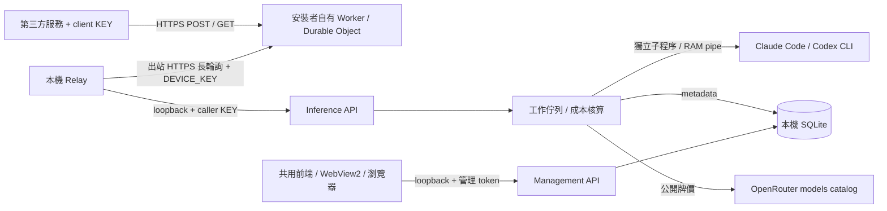

# 現行 BYO 架構

適用 `desktop_bridge/`＋`cloudflare/`＋Windows 安裝器。舊 `hosted/` 架構見 [歷史文件](01-architecture.md)，不作新版契約。

## 元件與信任邊界

| 元件 | 責任／來源 |
|---|---|
| 外部 Worker | `cloudflare/src/`：固定 HTTPS、client KEY digest 初檢、裝置在線、轉送／等候；不執行模型。部署專案由 `byo.py` 產生，不共用發布者 Worker。 |
| 本機 Relay | `desktop_bridge/relay.py`：出站 poll、同步有效 KEY digests、RAM 轉送、結果回送與退避重連。不開入站公網 port。 |
| Inference API | `service.py`：loopback HTTP、Bearer KEY、RPM／佇列、jobs／receipt、狀態與取消。 |
| 參數／工具 | `contract.py`、`tool_contract.py`：嚴格驗證；工具提案轉結構化輸出，再校驗原 schema；不執行呼叫端工具。 |
| Provider | `providers.py`、`process.py`：Claude 一次性無 session 持久化；Codex app-server ephemeral thread，隔離 cwd／工具；只停止 Bridge 自有程序群組。 |
| 成本 | `pricing.py`：讀公開牌價、15 分鐘快取、Decimal 換算；沒有送 prompt 到 OpenRouter，不需要 OpenRouter KEY。 |
| 資料 | `store.py`：SQLite／WAL、增量欄位補齊、KEY hash、設定、allowlist metadata；詳見 [SCHEMA](SCHEMA.md)。 |
| 管理 | `management.py`：另一個 loopback 隨機 port，獨立 token，Host／Origin 檢查，CSP、自有靜態檔。外部 Worker 不轉送 `/manage/*`。 |
| 前端 | `web/index.html`、`app.js`、`integration.js`、`style.css`：六個管理頁，無打包框架或遠端字型；`platform.js` 提供瀏覽器 clipboard／CSV 適配。 |
| Windows 薄殼 | `windows_console.py`＋`packaging/windows/platform.js`：WebView2、原生複製／儲存、備援瀏覽器。`console_extension.js` 僅於 Windows build 加入安裝／更新 UI。 |
| Windows 安裝／更新 | `windows_cli.py`、`windows_management.py`、`windows_updates.py`、`packaging/windows/`：PyInstaller＋Velopack，獨立版本／渠道／簽章及 profile 綁定。 |
| 發布 | `windows-installer.yml` 跑隔離 Setup→A→B；`windows-installer-publish.yml` 建置及公告；`publish_windows_installer.py` 核對公開不可變資產並簽 policy。不部署任何使用者 Worker。 |

## 一次請求的生命週期

1. 呼叫端帶 client KEY 與指定 model 發送 JSON。Worker 將有效來源請求交給已配對裝置；本機再次驗證 KEY、scope、參數及接單狀態。
2. 配額／佇列通過後，SQLite 寫 queued metadata；工作內容留 RAM。執行時重查撤銷狀態，先取得實際模型的有效牌價。
3. 以 Bridge 自有 CLI 子程序推論，讀 RAM pipe 中的回覆與 usage。保存可取得的 token／cost metadata，再驗結構化輸出／工具提案。
4. 成功回標準 completion；失敗回明確分類。同步完成結果可釋放；jobs／識別請求 RAM 結果約 10 分鐘，重啟不重播原文。receipt 可從 metadata 回 billing。
5. 撤銷 KEY 設取消旗標並停止該 KEY 的自有工作；其他使用者 CLI 視窗／程序不受控制。服務重啟把 queued／running 標為 interrupted。

## 憑證與身分分離

Cloudflare CLI 授權、Worker DEVICE_KEY、caller client KEY、本機管理 token、供應商 CLI 訂閱是五層憑證。URL 與 client KEY 屬於裝置 profile，不屬於 CLI account。DEVICE_KEY 存自有 Cloudflare secret 與本機 DPAPI；client KEY 完整值只一次顯示，SQLite 只有 digest／prefix。沒有中央 Supabase 或發布者憑證庫。

## 儲存與故障邊界

持久化內容只有設定、KEY metadata、請求 metadata、公開牌價與更新收據／備份。Worker 的請求與結果在 RAM；未用 Durable Object storage 保存原文。Bridge 不寫原始內容或 stderr／traceback；不表示 OS dump、第三方 CLI 上游或供應商雲端皆沒有資料。

斷線或關機可讓在途請求失敗；未知結果須查 receipt，不能盲目重試。只有 metadata，無法重啟還原回答或回放原請求。KEY hash 不能逆推出遺失 KEY。

## 更新與回復

固定 GitHub policy → 固定公鑰驗簽／反降版 → HTTPS feed／package hash → 排空本 profile → 備份 → 正常關閉自有 viewer 並等 OS exit → Velopack `HttpSource` apply → 相同 data-dir 重啟。更新不部署 Worker、不切換供應商帳號。0.7.0／0.7.1 客戶端有已知來源判斷缺陷，需一次新版 Setup 或受控簽章修復，見 [Windows 指南](WINDOWS-INSTALL-UPDATE.md)。

Mac 的啟動器、Keychain、並行與 release 為獨立平台責任。共用前端的可攜性不代表 Mac 已跑過本次新 UI；本次不修改 Mac launcher、Cloud 設定或 release。
