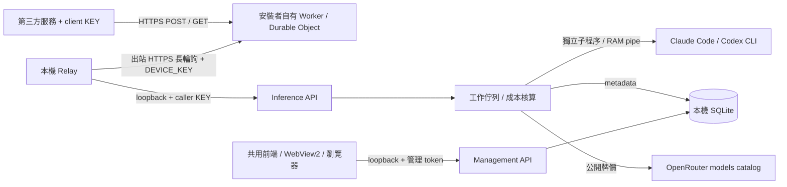

# 現行 BYO 架構

`public_endpoint.py` 為管理台提供明確觸發的公開路由檢查：無 Authorization 的 health GET 及新路徑的 GET／空 object POST，最多每路徑五秒，拒絕 redirect，不傳裝置憑證或 client key。401 只代表認證閘門可達；404 為待更新，其他結果未知。檢查不進 inference queue。`management.py` 分別維護路由證據與明確 Chat／Decisions 測試的 metadata；`handoff.py` 帶入狀態，不再把本機版本當成已部署證據。

Mac `macos_management.py` 使用共用管理 server 與 Windows onboarding coordinator 的平台方法；`macos_onboarding.py` 提供 Keychain／Terminal／source profile 適配，`macos_power.py` 僅管理 AC sleep。`macos_console.py` 是獨立 Cocoa／WKWebView viewer，憑證經 stdin，關窗不停止服務。來源更新由 `tools/mac_service.py` 排空、安裝與失敗回復；不使用 Windows 更新 feed。契約見 [Mac 設定](MACOS-SETUP.md)。

適用 `desktop_bridge/`＋`cloudflare/`＋Windows 安裝器。舊 `hosted/` 架構見 [歷史文件](01-architecture.md)，不作新版契約。

## 元件與信任邊界

| 元件 | 責任／來源 |
|---|---|
| 外部 Worker | `cloudflare/src/`：固定 HTTPS、client KEY digest 初檢、裝置在線、轉送／等候；不執行模型。部署專案由 `byo.py` 產生，不共用發布者 Worker。 |
| 本機 Relay | `desktop_bridge/relay.py`：出站 poll、同步有效 KEY digests、RAM 轉送、結果回送與退避重連。不開入站公網 port。 |
| Inference API | `service.py`：loopback HTTP、Bearer KEY、RPM／佇列、jobs／receipt、狀態與取消。 |
| 參數／工具 | `contract.py`、`tool_contract.py`：嚴格驗證；工具提案轉結構化輸出，再校驗原 schema；不執行呼叫端工具。 |
| Provider | `providers.py`、`process.py`：Claude 一次性無 session 持久化；Codex app-server ephemeral thread，隔離 cwd／工具；只停止 Bridge 自有程序群組。 |
| 成本 | `pricing.py`：讀公開牌價、15 分鐘快取、Decimal 換算；沒有送 prompt 到 OpenRouter，不需要 OpenRouter KEY。 |
| 資料 | `store.py`：SQLite／WAL、增量欄位補齊、KEY hash、設定、allowlist metadata；詳見 [SCHEMA](SCHEMA.md)。 |
| 管理 | `management.py`：另一個 loopback 隨機 port，獨立 token，Host／Origin 檢查，CSP、自有靜態檔。外部 Worker 不轉送 `/manage/*`。 |
| 前端 | `web/index.html`、`app.js`、`integration.js`、`style.css`：六個管理頁，無打包框架或遠端字型；`platform.js` 提供瀏覽器 clipboard／CSV 適配。 |
| Windows 薄殼 | `windows_console.py`＋`packaging/windows/platform.js`：WebView2、原生複製／儲存、備援瀏覽器。`console_extension.js` 僅於 Windows build 加入安裝／更新 UI。 |
| Windows 安裝／更新 | `windows_cli.py`、`windows_management.py`、`windows_updates.py`、`packaging/windows/`：PyInstaller＋Velopack，獨立版本／渠道／簽章及 profile 綁定。 |
| 發布 | `windows-installer.yml` 跑隔離 Setup→A→B；`windows-installer-publish.yml` 建置及公告；`publish_windows_installer.py` 核對公開不可變資產並簽 policy。不部署任何使用者 Worker。 |

## 一次請求的生命週期

1. 呼叫端帶 client KEY 與指定 model 發送 JSON。Worker 將有效來源請求交給已配對裝置；本機再次驗證 KEY、scope、參數及接單狀態。
2. 配額／佇列通過後，SQLite 寫 queued metadata；工作內容留 RAM。執行時重查撤銷狀態，先取得實際模型的有效牌價。
3. 以 Bridge 自有 CLI 子程序推論，讀 RAM pipe 中的回覆與 usage。保存可取得的 token／cost metadata，再驗結構化輸出／工具提案。
4. 成功回標準 completion；失敗回明確分類。同步完成結果可釋放；jobs／識別請求 RAM 結果約 10 分鐘，重啟不重播原文。receipt 可從 metadata 回 billing。
5. 撤銷 KEY 設取消旗標並停止該 KEY 的自有工作；其他使用者 CLI 視窗／程序不受控制。服務重啟把 queued／running 標為 interrupted。

## 憑證與身分分離

Cloudflare CLI 授權、Worker DEVICE_KEY、caller client KEY、本機管理 token、供應商 CLI 訂閱是五層憑證。URL 與 client KEY 屬於裝置 profile，不屬於 CLI account。DEVICE_KEY 存自有 Cloudflare secret 與本機 DPAPI；client KEY 完整值只一次顯示，SQLite 只有 digest／prefix。沒有中央 Supabase 或發布者憑證庫。

## 儲存與故障邊界

持久化內容只有設定、KEY metadata、請求 metadata、公開牌價與更新收據／備份。Worker 的請求與結果在 RAM；未用 Durable Object storage 保存原文。Bridge 不寫原始內容或 stderr／traceback；不表示 OS dump、第三方 CLI 上游或供應商雲端皆沒有資料。

斷線或關機可讓在途請求失敗；未知結果須查 receipt，不能盲目重試。只有 metadata，無法重啟還原回答或回放原請求。KEY hash 不能逆推出遺失 KEY。

## 更新與回復

固定 GitHub policy → 固定公鑰驗簽／反降版 → HTTPS feed／package hash → 排空本 profile → 備份 → 正常關閉自有 viewer 並等 OS exit → Velopack `HttpSource` apply → 相同 data-dir 重啟。更新不部署 Worker、不切換供應商帳號。0.7.0／0.7.1 客戶端有已知來源判斷缺陷，需一次新版 Setup 或受控簽章修復，見 [Windows 指南](WINDOWS-INSTALL-UPDATE.md)。

Mac 的啟動器、Keychain、並行與 release 為獨立平台責任。共用前端的可攜性不代表 Mac 已跑過本次新 UI；本次不修改 Mac launcher、Cloud 設定或 release。

## Windows 安裝協調層（0.8.0 候選）

`packaging/windows/onboarding.js` 只追加到 Windows 管理台，沿用共用設計 tokens／BridgePlatform，不改 Mac 前端。`windows_onboarding.Onboarding` 由 WindowsManagementServer 持有，loopback 管理權限保護；非同步工作不持有管理 mutation lock，狀態僅回 allowlist。不建立第二個 LLM agent，不將本地 CLI 用來編排 Cloudflare。

Velopack after-install hook 只寫安裝 UUID；一般 update 不觸發此 hook。coordinator 比對此 UUID 與 profile 的完成紀錄，首次顯示精靈、完成者跳過。部署仍走既有 BYO 帳戶鎖定及 pending secret 機制；KEY 仍在 SQLite 只存 hash；HTTPS proof 與完整 KEY 在 RAM，持久化只留測試 metadata。完成判斷在後端檢查，不信任前端自行送 success。

`windows_power.PowerPolicy` 與 `NativePower` 分離規則／Win32。同意並備份後只調整 AC 自動睡眠、休眠及 unattended sleep 三項 timeout，讀回並可還原；保留鎖定、螢幕、實體按鍵與 DC，不常駐改寫 HKCU。`windows_power_admin` 是電源 ACL 不足且明確點選後的 UAC 窄 helper，不操作 CLI 登入。限制見 [ONBOARDING](ONBOARDING.md)。[CI-CD](CI-CD.md)／[RELEASE](RELEASE.md) 為維護操作正本。

Windows 0.8.1 的安全邊界、依賴與 Schema／CLI 傳輸限制見 [SECURITY](SECURITY.md)；更新不重新授權 CLI、不重建 endpoint 或 KEY，也不自動部署 Worker。

## Mac 全機單實例

Mac source 0.9.1-mac.1 在共用啟動入口的 profile 鎖之後、Store／Runtime／API／relay 之前，以 `macos_instance.MachineInstance` 獨占綁定 `127.0.0.1:8919`。固定鎖地址不隨 data-dir、安裝位置、API port 或 OS 使用者改變；只 bind、不 listen、不傳送資料、不提供管理能力，不使用 reuse socket options。OS 在正常／異常程序退出時釋放；fd 不傳給子程序。相同 profile 的重開仍只喚回原視窗。不同 profile 或其他程式占用鎖地址時拒絕啟動，不嘗試辨識／停止占用者。

前景拒絕回 exit 2 並寫固定 stderr 訊息；`--background` 因忙碌拒絕回 exit 0，避免 LaunchAgent 的失敗重啟迴圈，須在原服務正常結束後明確重新啟動。其他鎖錯誤回 exit 2，不能退回無鎖執行。全機鎖不包含 profile 路徑／KEY／token。舊版不持有此鎖，升級前須正常停止舊版，不能宣稱可限制任意歷史 binary。

## Windows 全機單實例

Windows 0.9.2 在同一共用入口、Store／Runtime／HTTP／relay 前取得 `windows_instance.MachineInstance`。使用固定 `127.0.0.1:8919` 的 Winsock `SO_EXCLUSIVEADDRUSE` reservation，只 bind、不 listen、不傳送資料；不同 Windows 使用者及 Terminal Services session 共用核心網路位址。一般權限即可使用，不使用全域 event 的 ACL、不新增常駐系統服務或要求 UAC。正常／異常退出由 OS 釋放，不依賴 PID 檔或掃描其他程序。

同 profile 的原有 session event 仍負責喚回視窗；viewer 不占用另一把 runtime 鎖。不同使用者不分享管理 token 或 DPAPI。忙碌拒絕為 exit 3，包含 background／headless；`ensure_service` 遇到此碼立刻回報，不能每 200ms 重啟被拒程序。native CLI start、GUI／console、source launcher、捷徑與登入自啟最後都走共用入口。其他鎖故障 exit 2，不能退回無鎖模式。

更新先排空、備份、正常停止 service／viewer、等待退出，再啟動新版；全機鎖保留到所有元件停止。關窗 X 只關 viewer，API 與全機所有權仍在；明確結束才停止供應。停止不刪除 Worker URL；在線狀態可能滯後，不能當作實際推論成功證據。

只有非可分發 local_probe 建包可指定隔離 reservation，供同機測試 A→B；正式包沒有環境變數或 CLI 換鎖通道。CI 在可拋棄 runner 建立標準使用者與 SYSTEM 測試 broker，實際跨 TS session 驗證；broker 不隨產品安裝，不接觸 owner 工作站。規格來源：[Microsoft Winsock](https://learn.microsoft.com/en-us/windows/win32/winsock/so-exclusiveaddruse)、[CreateProcessAsUser](https://learn.microsoft.com/en-us/windows/win32/api/processthreadsapi/nf-processthreadsapi-createprocessasuserw)。狀態見 [Windows 收據](qa/2026-10-23-windows-machine-runtime.md)。

Mac 發布由 `packaging/macos/build.py` 以 tracked 公開來源 allowlist 建現行 BYO ZIP（不使用 legacy desktop builder），`macos-source-release.yml` 重跑 native／source／ZIP 真安裝後，以 main commit／hash 發布。source-release.json 讓無 .git 的下載包仍保留來源 SHA；詳細見 [Mac Release](MACOS-RELEASE.md)。

## 模型與 Decisions（0.9）

`model_catalog.ModelCatalog` 是依 provider scope 的 RAM cache：CLI 登入／設定 stat hash 識別世代，模型目錄 30 秒、推論證據 60 秒，重複 refresh 至少間隔 5 秒。Codex 的獨立 app-server 只做 model/list、不建立 thread／turn；Claude 沒有等價目錄，以登錄及近期證據呈現。查詢不寫 inference log，不傳原始憑證。

`decision_contract` 只接受明確 model 與有限 state／questions，生成不含 caller 自訂引用的 bounded schema；`Runtime` 用既有 queue／RPM／deadline 依題順序執行，每題 payload 只含本題與 state，透過既有 stdin 與無工具 provider。`decisions` 經隔離 validator 後計算答案／confidence；不是 Jev 原模型校準結果。逐次 quote.usage 後聚合，先保存已知計量再驗語意或執行後續題目；receipt 揭露未完整計量，不保存題目或答案。外部新增路徑只在 Worker 範本 allowlist，不隨 Windows 更新部署。

啟動入口以 ExitStack 保管已建立的 Store／Runtime／API／relay／management；中途初始化失敗與正常停止都先清理服務，再釋放 profile／全機鎖，避免已開 HTTP／推論仍活著卻允許第二套接手。
