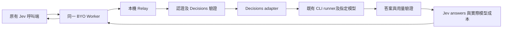

# 即時模型查詢與 Jev 相容 Decisions 實作計畫

日期：2026-10-23。狀態：設計基線；本機實作與使用方式見 [相容指南](JEV-COMPATIBILITY.md)，Luna 本機真實模型驗證已完成，公開部署與其他模型另行驗收。

目標是讓既有 OpenRouter Jev 呼叫端更換 endpoint、Bridge key 與 model 後，保留原有 `state`、`questions`、`provider.data_collection`，繼續讀取相同結構的 `answers`。Bridge 負責轉換模型輸入與輸出，呼叫端無須自行重寫成 chat body。

技術上可行。TypeSafe 官方也提供一般 LLM 實作 System One 介面的 adapter。可承諾的是已驗證範圍內的 HTTP 與資料結構相容；一般 LLM 的答案、機率校準、延遲及成本不會因此等同 Jev。既有以機率控制行為的應用，必須重新驗證門檻。[官方 adapter](https://github.com/typesafe-ai/system-one-adapter-python)

## 工作樹與現況

- 分支：`codex/jev-compat-plan`。
- 程式基線：`09894c849b73ea20f5de076fa12bb51c34d403de`，0.6.4。
- 原工作目錄仍有未提交內容，未納入這份功能變更。工作樹採用建立工具取得的 main，沒有把原目錄較舊的程式覆蓋進來。
- 制定計畫時僅新增規格；後續 0.7.0 已完成本機實作，並依追加授權覆蓋本機實驗安裝，結果見相容指南的驗證紀錄。未部署 Worker。

設計基線中的 `desktop_bridge/service.py` 已有依 key provider scope 篩選的 `/api/v1/models` 與 `/v1/models`，但來源是設定表，不是即時模型權限驗證。`providers.py` 的登入檢查也不能證明每個模型都能呼叫。

設計基線中的 `contract.py` 只接受 chat body；`state`、`questions` 會被拒絕。Cloudflare Worker 與本機 relay 都有路徑白名單，單改 Worker 不足以加入 Decisions。現有 `pricing.py` 已依 native model 對應牌價，`service.py` 已保留結構驗證失敗前取得的實際用量，可延伸使用。

## 對外相容契約

OpenRouter 官方 Jev 介面是 `POST /api/alpha/decisions`，不是 chat completions；輸出包含 `answers`、`model`、`usage`，並可有 `id`、`provider`。成本與 token 欄位使用 `usage.cost`、`input_tokens`、`output_tokens`。[OpenRouter Decisions API](https://openrouter.ai/docs/api/api-reference/alphadecisions/submit-a-decisions-request)

第一版實作相同路徑。`/v1/systemone` 與 `/api/v1/systemone` 是後續可選的 TypeSafe SDK 相容路徑，需各自完成 SDK 驗收後才宣告支援。

例如裝置已驗證 Haiku 可用時，範例僅把完整 URL 換為 `https://<自己的-worker>/api/alpha/decisions`、Authorization 換成 Bridge key、body 的 model 換成 `anthropic/claude-haiku-4.5`。`state`、三個 questions 與 provider 保留；呼叫端繼續讀 `answers.needs_response.noul`、`answers.disposition.choice`、`answers.tension.score`。這裡將需求中的「回傳 request 也保留」解讀為回應結構保留，不新增原始 request 回顯。

| 項目 | 提案行為 |
|---|---|
| 認證 | 使用此 Worker 原有的 Bridge Bearer key，沿用 provider scope 與撤銷機制 |
| `model` | 指定實際要執行的已登錄模型；不偷偷換成另一個小模型 |
| `state` | 保留 string、object、array 的原始 JSON 語意及 Unicode |
| `questions` | 保留題目 ID、順序、criteria 的描述與排列，不要求改成 messages |
| 題型 | 先支援此需求的 `noul`、`choice`、`score`；其他題型明確拒絕 |
| 輸出 | 保留原題目 ID 與 Jev answer 結構，不包成 `choices[].message.content` |
| 路由欄位 | `provider.data_collection=deny/allow` 沿用現有相容語意 |
| 其他欄位 | 逐項列明支援、接受但不執行的觀測 metadata、明確拒絕的功能；不可默默丟棄未知功能參數 |

`provider.data_collection=deny` 目前只是接受的相容欄位，不是訂閱供應商資料政策的驗證結果。本次維持既有契約，不能把它描述為已強制執行的隱私路由。`session_id`、`user`、`trace` 等官方 metadata 須測試接受規則；不將其當成系統提示，也不新增原文落盤或 Broadcast 行為。

「其餘 body 完全保留」首先適用於使用者提供的三題範例；不能直接推論為 OpenRouter 全部 routing、工具、圖片及未來題型都相容。拒絕不支援的欄位時應回到精確欄位路徑，而不是只回 unknown_field。

## 即時模型查詢

`GET /api/v1/models` 與 `/v1/models` 保持既有列表形狀。來源改為本機模型登錄、CLI 能力及登入狀態的交集，再套用呼叫 key 的 scope。公開 OpenRouter 模型目錄僅用來取得牌價，不可當成此裝置訂閱的可用清單。

另外提供 `GET /bridge/v1/model-capabilities`，回傳同一 caller 可見模型的 Decisions 支援狀態、native model 對應、證據來源、`checked_at`、有效期限及 `verified`、`unverified`、`unavailable`。保留標準 models 列表的舊客戶端相容性；詳細狀態放擴充端點。

判斷依據依序是 CLI 官方模型列舉能力、登入狀態、近期同模型成功結果及明確的模型權限錯誤。規格階段驗證 Codex 所安裝版本是否支援 `model/list`；Claude 若沒有可靠的訂閱模型列舉介面，就維持登錄模型加上明確的未驗證狀態，不用 API key 的雲端列表冒充訂閱權限。

列表無法保證下一次推論成功：額度、登入、服務故障都可能隨時改變。也無法在供應商不提供完整列舉介面時，保證找出訂閱內所有可呼叫模型。產品文字應說明「目前可見模型與最近驗證結果」，而不是「已保證全部可呼叫」。

- 查詢不隱藏執行付費或消耗訂閱的推論。需要真實驗證時，另提供明確的 `POST /bridge/v1/models/probe`，只接受 caller 已授權模型及固定合成測試。
- 提供 `POST /bridge/v1/models/refresh` 更新無推論的能力資料。現有 Worker 沒有轉送 query string，第一版不用 `?refresh=1`，避免公開端與本機行為不一致。
- 能力快取建議初始 30 秒，按裝置、登入世代、CLI 版本與模型設定版本隔離；每次回傳仍重新套用 key scope。撤銷 key、切換登入、變更模型設定後失效。
- 明確標示證據種類：登入成功不等於模型成功；429 是當下容量問題，不等於永久沒有模型權限。不得把不同帳號先前成功的證據繼續當成新帳號的成功。
- 裝置離線延續 503；不以沒有時效標記的 Worker 快取冒充即時能力。

第一版僅查詢這個 Worker 綁定的裝置/provider，不加入任意上游 URL 探測或供應商 API key 代管，維持 BYO 產品邊界。

## 模型選擇與處理架構



Worker 維持認證前置檢查、路徑白名單、期限與轉送；本機 Bridge 執行模型列舉、schema 編譯、推論、答案映射及成本核對。這樣可共用既有 CLI 隔離、key、佇列、取消與收據，不增加雲端模型憑證或第二條永久通道。

推薦使用當下經此裝置驗證、具結構輸出能力的小模型，例如可用的 Luna 或 Haiku。推薦名稱不是硬編碼的新權限：需先確認 native ID、CLI 訂閱權限、schema 能力及牌價映射。明確指定其他可用模型時就執行該模型；不可因它比較昂貴而私自改用 Haiku，反過來也不可偷偷升級。

不增加一個 LLM 先判斷「是不是 Jev body」：由 HTTP 路徑與確定性的 schema validation 判斷即可。省下額外呼叫、延遲及不透明成本。

TypeSafe 官方 adapter 可作協定與測試參考，但它的上游是 API SDK，本專案的上游是已登入 CLI。建議由自有的薄 adapter 接既有 runner，避免為了重用 adapter 而新引入 API key、另一套重試或用量計算。若複用其程式碼，固定版本並保留授權。[官方 adapter 的模式與重試設計](https://github.com/typesafe-ai/system-one-adapter-python)

## 答案生成與一致性

`noul` 回傳 0 到 1 的數字，不是 boolean，且沒有額外 `confidence`。[Noul](https://docs.typesafe.ai/primitives/noul)

`choice` 由完整的 option 分布決定 `choice`。`score` 的 criteria 從 0 編號，回傳分布加權平均，可為小數；五個等級就是 0 到 4，不擅自改成 1 到 5。[Score](https://docs.typesafe.ai/primitives/score)

由模型只生成必要的分布，再由程式計算贏家、score、legend、confidence；模型不直接編造這些互相制約的欄位。Choice 與 Score 的 confidence 公式不同，必須按固定的官方公式與 fixtures 驗證；Score 公式考慮等級距離，不能套用 Choice 的最大機率公式。[Confidence](https://docs.typesafe.ai/confidence)

編譯與驗證規則：

1. `instructions` 與 criteria 描述保留官方接受的 JSON 結構，不只支援範例中的 string。[結構化欄位](https://docs.typesafe.ai/primitives/advanced)
2. 每題建立嚴格 schema，必要時將外部題目 ID、option ID 映射成內部安全 ID；回傳再還原，不拿題目名稱當作判斷提示。
3. 拒絕漏題、多題、非法 option、缺少分布項目、bool 冒充數字、負值、NaN、Infinity 與超出範圍的結果。
4. 分布總和僅容許明確的小幅浮點誤差；不可把任意錯誤分布正規化成看似可信答案。答案的 rounding、tie-breaking 與總和容差固定成可測試規格。
5. `legend` 由原 criteria 生成，不能由模型改寫。state 與 criteria 作為待判斷資料，不得凌駕 adapter 的系統指令，禁止工具執行與額外資料存取。
6. 先完成該請求所有題目及成本驗證，再原子回傳完整 answers。任一題失敗回明確錯誤，不製造缺題的成功結果。

Jev 的多題語意要求每題獨立判斷；一次把所有題目塞進 LLM，無法保證不互相影響。因此相容優先版本預設每題只提供共同 state 與該題，沿用現有執行上限在同一工作中依序處理。此例三題可能形成三次同模型推論，成本全數加總；不多加一個路由模型。缺點是 CLI 啟動及重讀 state 的延遲與成本較高，需要以實測決定是否適合 90 秒公開請求期限。

單次合併多題可作後續效能模式，但要量測增加、刪除、重新排序無關題目是否改變答案，並公開這項差異。不得只為了速度把它當成 Jev 的隔離語意已被保證。第一版不做隱藏修復重試、不自動改模型；若後續加入重試，必須同時提供預算、期限及每次用量結算。

即使結構完全通過，上述機率仍是一般 LLM 估計，不能稱為 Jev 的校準結果。對判斷門檻的品質驗收須與 schema 驗收分開。

## 模型成本與收據

此處將需求第 3 點解讀為：所有成本均依實際執行模型及實際用量計算；選小模型才使用小模型牌價。沒有執行 Jev 就不能使用 Jev 牌價，也不使用未實際執行的便宜模型估價。

```text
本次 usage.cost = Σ 每次實際推論依對應模型和已知 token 明細計算的成本
```

- model 與 provider 回傳真實的 Bridge 模型及執行來源，不假裝是 TypeSafe。
- 對外 model 使用既有登錄 ID；內部仍核對 native model 與精確牌價映射，無法對應時不啟動推論。
- 一次外部請求的多題推論共用同一實際模型；逐次記錄 usage，再加總到外部請求。若供應商回報不同模型，必須明確失敗或採用經定義且可核對的解析結果，不能照原請求模型錯計。
- Decisions serializer 把內部 token 明細映射成 `input_tokens`、`output_tokens`，成本是數值，保留既有成本 headers。不可遺漏輸出、推理或已知快取分類，也不可重複計算推理 token。
- 訂閱 CLI 並不是按此次 API 請求向 OpenRouter 付費；`usage.cost` 延續目前的 OpenRouter 牌價估算定義，不宣稱實際帳單金額。[本專案成本定義](OPENROUTER-PRICING.md)
- 已有部分推論成功、之後某題失敗或 schema 無效，仍保留已知消耗。未取得用量不能填零，也不能宣稱沒有成本；收據須區分已知累計與用量不完整。
- 第一版不跨模型 fallback，避免一個 response.model 對應多模型成本的含糊情況。後續若要支援，需獨立設計分項收據。
- 收據及 log 只保存 allowlist metadata，如 protocol、模型、用量、成本、狀態及題數；不保存 state、答案、criteria、原始 CLI event 或可能含個資的題目 ID。

## 實作拆分與驗收

| 階段 | 主要變更 | 完成條件 |
|---|---|---|
| 1 協定及模型發現 | 凍結官方 request/response fixtures；新增 `model_catalog.py`；實測 CLI 列舉方式；擴充 models 與能力端點 | 不同 scope 的 key 只見自己的模型；登入切換與過期證據不誤報；無隱藏推論 |
| 2 Decisions 核心 | 新增 `decision_contract.py`、`decisions.py`；schema 編譯、答案映射、獨立題目執行及公式測試 | 三題範例與邊界 fixtures 通過；格式錯誤明確失敗；chat 行為維持 |
| 3 執行與成本整合 | `service.py` 加入 protocol 與 response serializer；擴充用量聚合、收據與取消；`store.py` metadata 遷移 | 實際模型、tokens、成本、收據吻合；部分失敗不歸零；重複請求不重跑 |
| 4 Relay 及使用端驗收 | 同步 `cloudflare/src/worker.js`、`desktop_bridge/relay.py` 的白名單；更新 handoff、Web Console、文件與版本 | 真實 HTTP client 僅換 URL/key/model，body 其餘欄位及答案解析程式維持 |

API path 須在 Worker、本機 Relay、service 三層一致。共用 protocol 的驗證及 serializer，不複製一整套 Runtime 或 CLI runner；維持既有一個執行工作、有限佇列及每把 key 限流，避免把一份多題請求轉成無上限並行。

整體工作量中等，主要不確定性在 CLI 模型列舉、每題獨立執行的延遲，以及既有 Jev 門檻能否維持業務品質。先完成階段 1 的能力 spike 與三題往返量測，再估發布時間；不在量測前承諾小模型必然更快或更便宜。

驗收應包含：

- 移植前後只變更 endpoint、key、model；比較輸入 JSON，並用同一份客戶端答案解析程式讀取 response。不能要求新增 messages 或 response_format。
- OpenRouter 官方 fixtures、三題範例、JSON state、結構化 criteria、中文、特殊 option 名稱、score 邊界、同機率、分布總和、惡意指令及缺題輸出。
- 無效與已撤銷 key、scope 越權、登入失效、模型不存在、模型自動降級、額度不足、牌價過期、排隊、取消、裝置離線及 relay 重啟。
- 多題總量與分項用量核對；部分失敗仍有收據；408 或傳輸中斷不自動重送已受理的推論；已 dispatch 的請求不因更新重播。
- Windows 隔離測試 profile，使用合成內容。新建測試 key 結束撤銷，既有使用中 key 不輪替。沿用原 Worker/裝置設定；macOS 不列為已驗收。
- 品質另用人工標記的判斷集比較 false positive、false negative、choice 準確度、score 誤差、Brier score 或校準曲線，以及 p50/p95 延遲和每請求成本。尚未量測前不承諾與 Jev 相同數字；是否達標須依使用端的錯誤容忍度預先設定。

必要回歸指令：

```powershell
python -m pytest desktop_bridge/tests -q
node --test cloudflare/test/relay.test.js
python tools/lint_terms.py --require
```

此 repo 是本機 Bridge 加 BYO Worker，不適用 AI GO Custom/Hosted App 發布流程。外部驗收需在使用者指定的自有帳戶與裝置 profile 上進行；本次設計工作不包含部署、登入切換、正式 registry 切換或發布安裝包。

## 設計階段基線驗證

制定計畫時，2026-10-23 在本工作樹驗證：Python 95 passed、1 skipped；Worker 7 passed；必要禁字檢查 22 項無命中。Python 測試使用工作樹內隔離 venv 的鎖定依賴，沒有修改全域 Python 套件。計畫文件的 secret pattern 掃描無命中。

以上是 0.6.4 基線與文件檢查，不是新 Decisions 功能驗收；沒有執行真實模型推論或外部部署。

## 實作驗證的既有歷史閘門

0.7.0 功能與工具共 207 項 Python 測試通過、1 項平台限定跳過，Worker 11 項通過，真實 Luna 三題結果見相容指南。工作區禁字及機敏資訊掃描通過。額外的全歷史禁字掃描 `lint_terms.py --commits --require` 在既有基線提交 `09894c84` 訊息第 13 行命中清單第 2 項；本次功能提交無命中。未改寫既有提交，完整歷史的這項檢查仍未通過。
