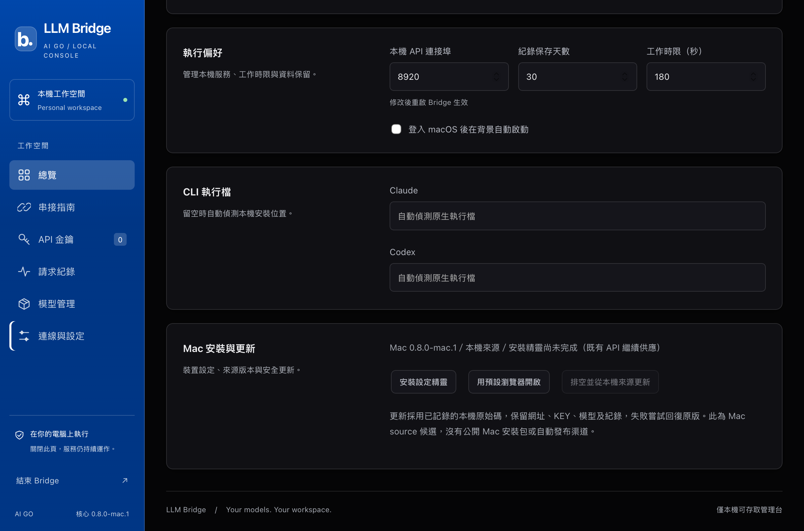
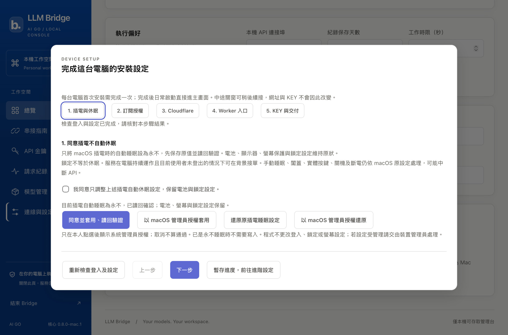

# Mac 0.8.1 source 同步驗收

狀態：本機 source 適配、原生 renderer 及現有 Mac 安裝更新／外部 HTTPS 通過。初輪來源 `4445670`；最終安全整合來源 `d50ab50`，Mac source `0.8.1-mac.1`；未發布 Mac release，未驗項不得當成通過。

## 來源及範圍

- 初始來源為 Windows 0.7.3 主線 `d3f2707` 及 0.8.0 候選 `22c843c`；PR #17 最終整合已發布 Windows 0.8.0 的主線 `32eeb80`，保留其發布收據，改以 main 為合併目標。
- 原 Mac 安裝 `0.6.6-mac.2`；同步六頁設計、首次設定、BYO／KEY／HTTPS 交付、WKWebView、AC sleep 與來源更新。
- 沿用原 Mac profile，不操作遠端 Windows、其他 Cloud 專案、個人 CLI 登入或鎖定設定。
- 電源寫入、授權取消及還原使用 fake adapter；本機只讀現有設定。真 OAuth／新 Worker 部署不因升級重做。

## 驗證紀錄

| 檢查 | 本輪結果及範圍 |
|---|---|
| Python | `pytest desktop_bridge/tests packaging/windows/tests tools/tests desktop_platform/macos/tests -q`：241 passed、4 skipped。Mac adapter、AC-only 同意／取消／備份／還原、pending 恢復、原生操作邊界、同 KEY proof、更新失敗回復均包含；Windows OS 測試留在 Windows。 |
| Node | relay 7 passed；Windows platform seam 2 passed。 |
| 版本／文件／機敏掃描 | `tools/version.py --check`、`tools/check_product_docs.py`、`tools/scan_secrets.py`、`git diff --check` 通過。 |
| 必要禁字檢查 | 本機 `tools/lint_terms.py --require` 沒有私有清單；由有 repository secret 的 [PR CI](https://github.com/AI-GO-APP/aigo-llm-bridge/actions/runs/39893158743) 完成 lint-terms／secrets／docs／version-bump 等檢查並通過，不虛構清單或降低規則。 |
| 真 WKWebView | `tools/verify_macos_console.py`：六頁、五步精靈、Mac 卡，light／dark × 1200／480px 共 48 個版面變體；全頁無橫向溢出。實際渲染後檢視代表圖，並非只檢查 CSS 字串。 |
| 原生橋接 | 前端呼叫真 pbcopy 並讀回中文；保留 CSP `script-src 'self'`，固定三個 closure 介面，不開 unsafe-eval；外部導覽在 WKNavigationDelegate 阻擋。 |
| 原生 CSV | 真 NSSavePanel Cancel，以及原生 panel 自動選中文檔名後 Save，匯出 metadata／0.012345 USD 回讀通過。chooser 的回傳與取消亦有獨立測試；不是人工點選證據。 |
| 視窗生命週期 | viewer 關閉後本機 `/health` 仍為 200；關閉精靈清除 KEY 欄位。 |
| 隔離真安裝 | source installer 實際安裝 Cocoa 依賴，安裝後 headless `/health` 為 0.8.0-mac.1，Mac 及產品文件隨附。沒有新建 Worker。 |
| 既有 Mac 真升級 | `tools/verify_macos_upgrade.py --apply`：0.6.6-mac.2 → 0.8.0-mac.1；device ID、固定 URL、原帳戶／Worker、全部既有 KEY 完整 rows、七模型映射、預設模型及四路容量一致。 |
| 同 KEY 外部驗證 | 同一臨時 Codex KEY 在升級前後 GET models 200；更新後一般 chat 200，5.733 秒，model=openai/gpt-6.1-sol，usage.cost=0.008446 USD 牌價估值，請求前後系統皆回報鎖定。 |
| 結構化／工具／邊界 | 外部 JSON schema 200；指定工具提案 200／arguments 合規且未執行主機工具；相同 request ID 回相同結果且不新增 DB request；temperature 回 400 unsupported_parameter；第三方交付欄位完整。 |
| 測試 key 清理 | 升級跨版本臨時 key 撤銷；原 owner service keys 完整保留，不建立替代長效 KEY 冒充原 KEY。 |

## 最終主線整合複驗

- PR #17 改以已發布 Windows 0.8.0 的 main 為目標；衝突處保留 Windows 發布紀錄與 Mac 共用 coordinator hooks，Windows package target／signed policy 未改。
- 整合後本機 Python 回歸仍為 241 passed、4 skipped；relay 7 及 Windows adapter 2 通過，版本／文件／機敏掃描通過。沙箱限制 loopback bind 的失敗已在取得權限後重跑通過。
- 已安裝 runtime 與最終來源的 Python／JS／CSS／HTML 逐檔相同；LaunchAgent 與 health 通過。再次鎖定狀態下 HTTPS models 200／七模型，合成 chat 200／6.102 秒／0.008452 USD；請求前後鎖定，既有 endpoint、全部 KEY rows、模型與四路容量相同，臨時驗收 KEY 已撤銷。
- 前一來源 `f5d8487` 的 [Windows 真安裝及更新回歸](https://github.com/AI-GO-APP/aigo-llm-bridge/actions/runs/39893545138) 完成：核心、真 Setup→A→B 與拋棄 runner 的原生 AC 套用／還原均通過。主線整合後仍須等待新來源的全部 CI 成功才合併。

## 0.8.1 安全主線整合

- 驗收期間 main 新增 `fda2435`（PR #18）：保留整批 Windows 0.8.1／core 0.6.7 修補及 Windows package target，Mac 候選提升為 `0.8.1-mac.1`；解決版本、文件及 D 編號衝突。Mac onboarding prompt 同步 Node／Wrangler 安全基線，Mac workflow actions 固定 commit。
- 整合後本機 251 passed、4 skipped；Node relay／Windows adapter 共 10 passed，版本／產品文件／機敏掃描通過。
- 真實 source 升級 `0.8.0-mac.1` → `0.8.1-mac.1`：同一臨時 KEY 升級前後 models 200；device／URL／帳戶／Worker／全部既有 KEY rows／七模型／四路容量一致。鎖定前後 chat 200、6.365 秒、usage.cost=0.008450 USD；request ID 去重、JSON schema 200、工具提案 200、unsupported_parameter 400 及 handoff 皆通過，臨時 KEY 撤銷。
- Mac 共用安全程式包含 Relay redirect 拒絕／有界讀取、provider environment allowlist、stdin caller data 與 schema 子程序預算。Windows Job Object 的記憶體限制不能當成 Mac 保證，見 MACOS-SETUP；既有 Worker 未自動部署。

- 最後 UI 文字同步使用來源 `936ff38`，逐檔核對 Python／JS／CSS／HTML 一致，health、原 KEY／設定及穩定 manifest LaunchAgent 通過。額外 in-process 驗收 wrapper 曾載入 checkout 套件而選錯啟動器，health 閘門回復 manifest；改用正式獨立安裝 CLI 後更新成功，未加 runtime 繞過或放寬閘門。
- `936ff38` 的 [通用 CI](https://github.com/AI-GO-APP/aigo-llm-bridge/actions/runs/39895242112)、[Mac 原生／source](https://github.com/AI-GO-APP/aigo-llm-bridge/actions/runs/39895242145)、[Windows 桌面](https://github.com/AI-GO-APP/aigo-llm-bridge/actions/runs/39895242129) 與 [依賴安全](https://github.com/AI-GO-APP/aigo-llm-bridge/actions/runs/39895242138) 通過；[Windows 真安裝／更新](https://github.com/AI-GO-APP/aigo-llm-bridge/actions/runs/39895242110) 最後另行核對。這份文字收據不取代 [PR #17 最終來源的全部 checks](https://github.com/AI-GO-APP/aigo-llm-bridge/pull/17/checks)；合併須全部通過。

## 已知邊界與操作紀錄

- 實際部署、OAuth、管理員電源寫入及 Claude 訂閱真推論沒有重做。既有 Codex／Keychain／Relay 實際使用；電源改動及取消以 fake adapter 驗證，不以此聲稱工作站已套用新電源設定。
- 現有有效服務不因新精靈未完成而被阻擋；本人仍須明確同意電源步驟及完成 KEY 保存／交付勾選，不能為了驗收偽造完成紀錄。
- 某輪 unattended Save 測試曾卡在額外對話框，只結束該測試程序，未動正式 Bridge；該輪未能恢復原剪貼簿，已告知 owner。後續改為複製檢查後立即還原，再做 modal 測試。
- 來源更新不是 Windows 簽章 feed；沒有 Mac .app／DMG 發布、強制更新政策或 OS 登出後供應保證。
- [Mac CI](https://github.com/AI-GO-APP/aigo-llm-bridge/actions/runs/39893158616) 的 legacy verify 與新 BYO source／真 Cocoa renderer 皆通過。首輪 Windows runner 找出兩個 Mac 測試對 OS 的假設：Python 解譯器可有 `.exe`，POSIX update lock 不在 Windows 執行；已修正測試邊界並重新執行，不將失敗隱藏成 Windows 功能通過。

原始內容與完整 KEY 只在 RAM。報告不含 endpoint、帳戶 ID、管理 token 或原始模型輸出。
