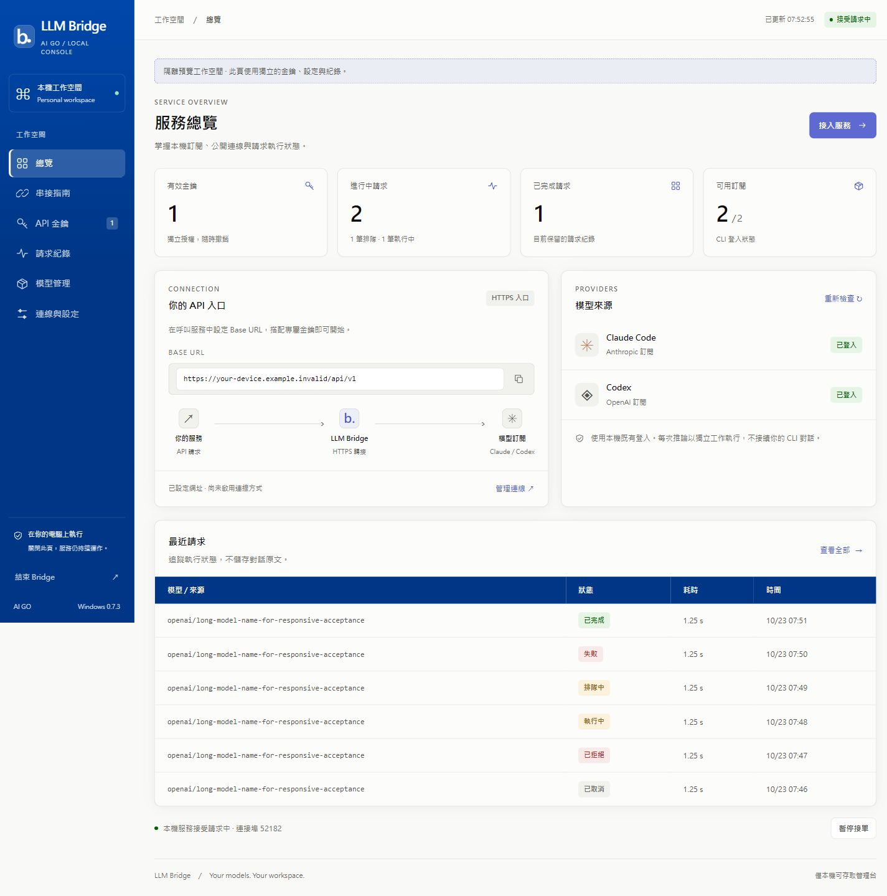
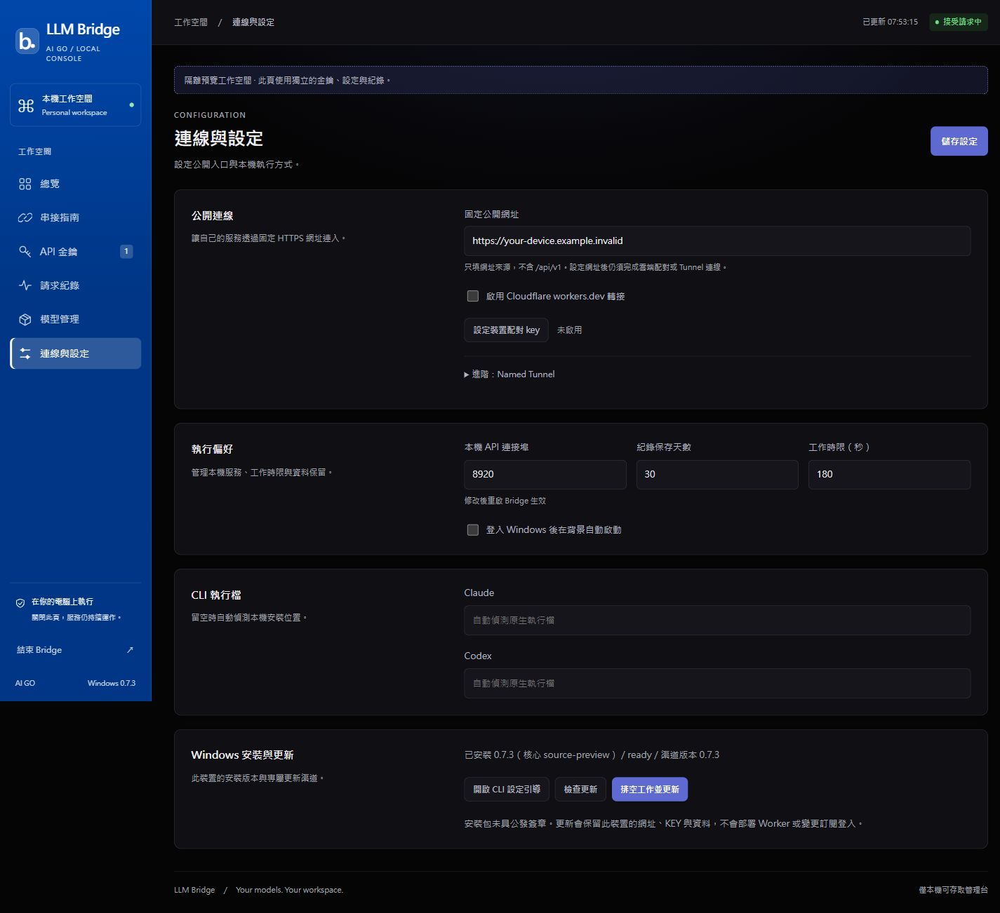

# Windows 0.7.3 設計與文件驗收

範圍：Windows視覺更新與repo文件體系。採深藍／靛藍合約請款視覺語言、系統深淺色、六頁與Windows更新卡；不修改供應商登入、不部署Worker、不發布Mac。版本與資料分離；沒有DB schema變更。

## 驗收紀錄

本檔在工作開始先建立。以下結果須完成實測後更新，不能以規格代替證據。

| 閘門 | 本輪狀態 |
|---|---|
| 文件覆蓋／連結、隨包文件 | schema／settings／API／tokens及連結檢查通過；隨包stage待native建置 |
| Python／Node／terms／secret檢查 | 147 Python passed、2 skipped；Node relay 7＋platform 2 passed；22字詞及secret掃描通過 |
| 六頁淺深色與窄版render、modal、Windows卡 | 1440×1000及390×844，淺／深色×六頁24組均無整頁橫向溢出；建立KEY modal四組尺寸／主題皆完整、兩來源預選；輪替取消、空篩選、成本欄及keyboard focus通過；無console error |
| 隔離Setup→A→B、native copy／CSV／關窗 | 待執行 |
| PR／CI／公開Windows release | 待執行 |
| 正式Windows更新與URL／KEY／資料保留 | 待執行 |

Mac新UI未驗收，瀏覽器／WebView共享前端不代表Mac原生殼驗收通過。所有驗證使用合成profile／內容；公開報告不含完整KEY、管理URL fragment或個人資料。

## 視覺證據與範圍

以下為實際內建瀏覽器render，獨立合成profile，沒有CLI推論或Cloud部署；Windows更新卡由實際console_extension注入，版本標記source-preview，不能代替frozen安裝證據。完整24組尺寸收據與截圖保留於本機忽略的design-visual證據目錄。

主要前景對比實測：淺色內文19.17、說明5.53、操作文字5.75；深色16.24／7.96／8.80；主按鈕白字4.70、深藍表頭白字11.25。上述達4.5:1目標，不宣稱完整WCAG認證。鍵盤Tab移至下一導覽時有solid outline。空篩選可見明確說明，成本0.012345正確顯示。
