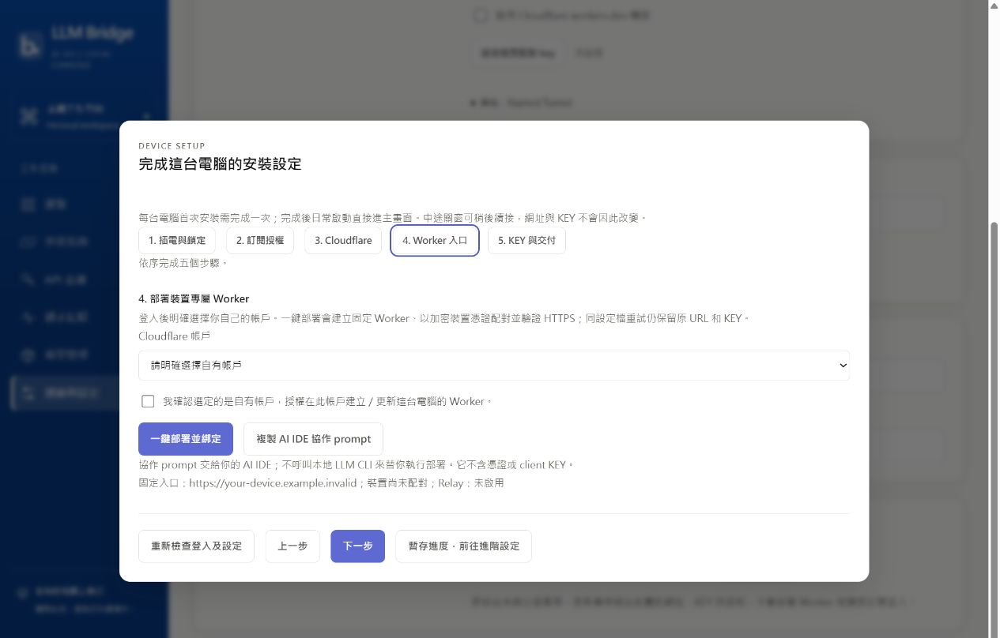
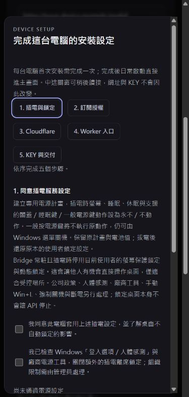

# Windows 0.8.0 onboarding 候選驗收

以下記錄為修訂前含鎖定設定候選的歷史收據。最新 AC-only 候選及 Win+L 實測見 [鎖定 QA](2026-10-23-windows-locked.md)，不得將下列舊原生電源結果套用至修訂版。

先前階段：原始碼／CI／隔離安裝驗證通過，**尚未發布／未升級正式 Windows**。原正式 0.7.3 與其先前已知 Worker 500/1101 是不同狀態；本輪不修／不部署該 Cloud，也不改正式機電源或既有 Claude Code。

先前功能來源 `80fe9074d709084d180381e9601271aba17ec5ca`，[PR #15](https://github.com/AI-GO-APP/aigo-llm-bridge/pull/15)。本機完整 Python **174 passed、2 skipped**，onboarding 專屬 25 案例、console boundary 16；relay 7、平台 adapter 2；文件覆蓋、terms、secrets 通過。[一般 CI](https://github.com/AI-GO-APP/aigo-llm-bridge/actions/runs/39881637172)、[Windows ZIP／指南](https://github.com/AI-GO-APP/aigo-llm-bridge/actions/runs/39881637160)、[Windows installer／原生電源](https://github.com/AI-GO-APP/aigo-llm-bridge/actions/runs/39881637166) 全通過。沒有 Mac release 或自有 Worker 部署。

| 案例 | 狀態／邊界 |
|---|---|
| 新 profile 必須 onboarding、完成後日常跳過、升版保留、重裝安裝 ID 改變 | fake coordinator 回歸通過，原生 Setup／update 另記 |
| 訂閱 ready 不重新登入、active request 拒絕登入 | fake process／status 回歸通過；未對目前 Claude 執行登入／登出 |
| Cloudflare 帳戶選擇、錯帳戶拒絕、無憑證 AI IDE prompt | adapter 回歸通過；未對正式 Worker 變更 |
| 新 KEY 全來源、一次交付、完成檢查、metadata only | 隔離 Store＋adapter 回歸通過；真 Cloud OAuth／BYO 另驗 |
| 缺失／布林／字串／負／NaN／Infinity cost 不通過 | HTTP adapter 回歸通過，包含 GET→POST 順序；不算真供應商 inference |
| AC-only、DC 原值、鎖定原值、失敗 rollback、組織限制、不覆寫 owner 新計畫 | fake native adapter 回歸通過；owner 工作站無電源寫入 |
| UAC 同意／取消、alternate admin 的 HKCU 分離 | 未有真人 UAC 操作證據 |
| 真 Windows runner 電源套用／還原 | **6/6 通過**：apply/readback、DC 不變、原計畫不變、原計畫還原、registry 還原及無管理政策；只在可拋棄 GitHub-hosted runner，未改 owner 電腦 |
| 真 Setup→A→B、renderer 五步、重啟／更新不重跑、URL／KEY／資料不變 | 本機與 CI 均 **48/48 通過**；使用臨時 signer／獨立 pack ID／合成 profile，未向 Cloud 發送 inference |
| 最終 0.8.0 frozen 候選本機 API、手動重開精靈、立即重啟 | **12/12 通過**；新 profile、實際 KEY／GET models、無隱含電源變更、完成 fixture／device ID 保留及 open 旗標不重播；背景執行、不開管理視窗 |
| 五步 UI 深淺色、1280×900／390×844 | **20/20 無水平溢出**，電源／部署授權預設不勾；真 IAB renderer、合成只讀資料。修正 inline style 被 CSP 阻擋，改 Windows 同源 CSS，不放寬 CSP |
| 本人 CLI／Cloudflare OAuth、一鍵新 Worker、真 LLM PONG／cost、實體拔插電／待機 | 未驗；需指定乾淨安裝者環境，不能以 mock 或既有登入代替 |

文件：[ONBOARDING](../ONBOARDING.md)、[CI-CD](../CI-CD.md)、[RELEASE](../RELEASE.md)；需求 R-14～18、決策 D-16～20。發布／正式已安裝需通過相應閘門後另記，不能把候選版號當作完成。

## 證據細節

- CI `windows-installer-acceptance` artifact 內的 `bridge-update-proof/acceptance.json` 與 `bridge-onboarding-power/acceptance.json` 已下載回讀，success=true；不是只看 job 狀態。
- 隔離 Setup→A→B 使用名義版本 0.7.0／0.7.1，但兩包都是本次功能來源；不能當作正式 0.7.x→0.8.0 已升級。本機第一輪為 dirty LocalProbe；最終 CI 為 `80fe907` 乾淨功能來源。
- A→B 的 completed_at 是明確標記的**合成生命週期 fixture**，用於驗證檔案／日常跳過／備份保留。這不是經正式 finish 授權完成的紀錄，不算本人已完成新 Worker 授權；後端完整 finish 條件由 adapter 整合測試驗證。
- 現有 Windows 的 PowerGetActiveScheme／PowerReadAC/DC 僅唯讀檢查成功；沒有 PowerWrite、切計畫、registry 修改、UAC、logout/login。安裝者的實體 DC 切換、闔蓋／待機與受管理機器仍待實機驗收。
- 真人 UAC／新 CLI 與 Cloudflare OAuth／首個新 Worker／真 LLM HTTPS 是剩餘安裝者驗收；已向使用者詢問另一台 Windows／測試 VM 或先交付候選，不能為了填滿表格修改正在使用的正式 Windows。

## 最終候選包與修復

本機乾淨 `80fe907` 建立 Windows 0.8.0，core `0.6.6-mac.2` 未變。Setup **39,925,651 bytes**，SHA256 `8e976beab1167e794477409f9d3e1f59c056143661619c22d6828f95c902aed6`；full nupkg **32,411,539 bytes**，SHA256 `fc201008e5b1667ba9bfd8aea1d61183cc199a629da22cdd8994682110ead61b`。兩檔已從實際 bytes 獨立回讀；候選 self-test 的 resources／CA／document_links／deployment_template 全 true。產物在忽略目錄 `.desktop-build/onboarding-candidate-0.8.0-r3`，尚未公開 Release／更新 policy，也未執行此正式 pack ID 的 Setup。

前一候選 R2 的快速停止→立即啟動實測失敗：控制檔已刪除，舊服務仍持有 instance lock，首次新程序正常退出而未接管，原 ensure_service 等到逾時。失敗收據已明記 false，不能因部分先前 check=true 報為整體成功。修正後會等待原 profile 的鎖釋放，再啟動一次；真正錯誤 exit code 不反覆重試，不殺舊程序。新增可控時序測試（鎖仍忙兩次後釋放）及真 frozen R3 的無額外 sleep 立即重啟，12 項全通過。

`onboarding open` 現可明確手動重開已完成精靈；一次 RAM open/opened 旗標經前端確認即清除，不抹 completed_at，也不讓下一次日常啟動重開精靈。已安裝正式檔案另唯讀核對仍為 Windows 0.7.3／`d3f2707`。

後續新增「暫存進度，前往進階設定」：真合成 UI 已驗證關閉精靈後可進設定／模型頁，設定卡仍顯示首次安裝未完成，並能返回精靈；不假存完成旗標。新同意文案明確揭露一般電源鍵設不動作；390px 深色畫面再次檢查無水平溢出，本文兩張圖已更新。交付模型或 native/provider 對應若在測試後改變，現在必須重新 verify；onboarding 專屬測試更新為 26 案例。後續候選將另列來源／hash，不以先前包充當新增行為已封裝。

